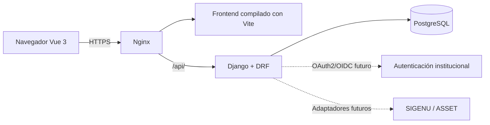

# Arquitectura propuesta

Diseño documental para satisfacer [REQUISITOS.md](REQUISITOS.md) y reproducir [PANTALLAS.md](PANTALLAS.md). Las soluciones técnicas son propuestas; no se implementan servicios ni se fijan versiones/bibliotecas sin comprobar compatibilidad en la fase autorizada.

## Componentes

Monolito modular Python/Django/Django REST Framework; frontend Vue.js 3 con Vite; PostgreSQL; Docker Compose; Nginx para despliegue; OpenAPI/Swagger; Git y GitHub. El PDF permite Django y GitHub aunque incluye una estructura de ejemplo Laravel y bibliotecas PHP: se adapta al stack solicitado.

Compose futuro: backend, frontend Vite para desarrollo, PostgreSQL y Nginx. En despliegue, compilar frontend y servir archivos desde Nginx; servidor Python de aplicación por elegir. Solo entrada Nginx pública en producción; backend/BD en red interna y volumen PostgreSQL persistente. Migraciones controladas y configuración por entorno. No se crea Docker ni se inicializa/publica repositorio ahora.

## Organización propuesta

Conservar directorios existentes `backend/`, `frontend/`, `docs/`. Backend futuro: `config/` y `apps/<modulo>/` con modelos, API/serializadores, permisos, servicios y pruebas. Frontend futuro: `src/` con vistas, componentes, router, cliente API y módulos. Estas rutas son diseño, no archivos creados.

| Módulo | Responsabilidad |
|---|---|
| identidad | Usuario institucional, RBAC y ámbitos, adaptador OIDC; RF-01, RNF-02 |
| nomencladores | Sedes, áreas, departamentos, tipos y campos configurables; RF-01 |
| solicitudes | Baja, Excel/plantilla, área, revisión y Economía; RF-02–05 |
| deposito | Recepción e inventario; RF-06 |
| despiece | Solicitud, aprobación, agenda y ejecución; RF-07 |
| almacen | Unidades, búsqueda, reservas, extracción e instalación; RF-08–09 |
| traslados | Solicitud, aprobación y salida; RF-10 |
| reportes | Filtros, trazabilidad y exportaciones; RF-11 |
| notificaciones | Mensajes internos y correo opcional; RF-12 |
| auditoria | Acciones y acceso exclusivo administrador; RNF-02/06 |

Servicios de negocio ejecutan enviar/aprobar/recibir/reservar/instalar dentro de transacciones. API valida rol, ámbito, objeto y estado; no permitir un PATCH genérico que salte aprobaciones. Consultas filtran por ámbito, permisos de objeto y denegación por defecto. Política documental por acción y preguntas de alcance en [PERMISOS.md](PERMISOS.md); ND y ámbitos sin resolver no se convierten en permisos globales. Modelo conceptual y restricciones en [MODELO_DATOS.md](MODELO_DATOS.md).

MovimientoEconómico guarda la petición del jefe de departamento y el vínculo al listado definitivo/sede; Economía procesa externamente y registra aprobación. Su inicio interno, referencias contables y multiplicidad operativa siguen pendientes, sin inventar integración automática. La transición autorizada, su aprobación y los eventos de negocio/auditoría se conservan de forma consistente; notificaciones se entregan tras commit.

Trazabilidad se reconstruye mediante documentos relacionados y EventoDominio con enlaces EventoEquipo/EventoPieza: baja → aprobación → movimiento económico → recepción → inventario → despiece → pieza → reserva → instalación en receptor, o traslado de equipo. Equipo unifica identidad sin exigir que receptor externo ingrese al depósito. Reserva es la asignación opcional de la solicitud pendiente y obligatoria al aprobar; no hay dos campos independientes que compitan por identificar la pieza. LogAuditoría registra acciones de seguridad y no se expone por endpoints de trazabilidad.

## Interfaz y API

Vue reproduce barra lateral, tarjetas, tablas, formularios, badges, timeline y modal del HTML; completar vistas faltantes tras autorización. Componentes reutilizables y validación en español; acciones según permisos/estado del backend. Ocultar un botón no protege API. Validar responsive contra dispositivos y Manual de Identidad UHO aún no disponible.

Propuesta: API versionada `/api/v1/` para nomencladores, solicitudes, revisiones, recepciones, inventario, despiezes, piezas, extracciones, traslados, reportes, notificaciones y auditoría. Acciones explícitas de transición; paginación, ordenación permitida, filtros RF-06/08/11 y errores consistentes. OpenAPI 3.0 con Swagger en `/api/docs` (ruta sugerida por PDF); documentar archivos, permisos, estados y errores. Política de acceso a documentación pendiente.

XLSX/CSV importados con validación servidor y errores por fila; plantilla XLSX; propuesta: validar antes de confirmar para evitar cargas parciales inadvertidas. Reportes PDF/Excel y CSV para intercambio; respetar filtros/ámbito y proteger fórmulas en archivos exportados. Bibliotecas Python se elegirán posteriormente.

## OAuth2/OIDC e interoperabilidad futura

El PDF identifica `auth.uho.edu.cu`; no incluye issuer verificado, discovery, client ID, secretos, redirect URIs, scopes, claims, JWKS ni logout. No se inventan ni prueban configuraciones. SIGENU/ASSET quedan tras adaptadores pendientes de contratos y alcance (D-15).

Propuesta sujeta a contrato: Authorization Code con PKCE y backend como cliente cuando lo admita la institución; validar state, nonce, firma, issuer, audience y vigencia. Identidad local mínima, contraseña inutilizable y roles internos separados de claims no confirmados. No habilitar contraseñas locales como alternativa temporal.

### Decisión pendiente AUTH-01 — Sesión del navegador y credencial API

Estado: **pendiente**, sin elegir por defecto JWT ni sesiones con cookies. Fuente: PDF sección 7 recomienda OAuth2/OIDC + JWT; RNF-02.2 exige integración institucional y no almacenar contraseñas locales. OIDC resuelve la identidad federada; no determina por sí solo cómo mantiene sesión nuestra aplicación. JWT es un formato de token; cookie es un mecanismo de transporte, por lo que no son opuestos absolutos.

| Alternativa propuesta | Ventajas y costes que deben evaluarse | Condiciones pendientes |
|---|---|---|
| Sesión opaca Django en cookie Secure/HttpOnly/SameSite; tokens OIDC en backend si son necesarios | Revocación/control central de sesión; necesita estado servidor, protección CSRF y política de expiración/logout | Compatibilidad del cliente institucional, origen de frontend/API, infraestructura de sesiones y aceptación de desviación respecto a JWT recomendado |
| API con access token JWT validado en servidor | Posible uso por otros clientes; requiere validar firma/issuer/audience/expiración y diseñar renovación, revocación y logout | Confirmar si UHO emite access tokens adecuados para esta API, claves/rotación, audiencias, scopes y consumidores; no emitir ni aceptar JWT por suposición |

Si un token se transporta en cookie sigue requiriendo análisis CSRF; si es accesible a JavaScript aumenta exposición ante XSS. Propuesta de seguridad: no persistir tokens en localStorage. No usar ID token como access token de nuestra API ni aceptar tokens cuya audiencia no sea válida. Sesión de navegador y autorización de clientes externos pueden requerir soluciones diferentes; no añadir esos clientes como requisito sin acuerdo.

Antes de cerrar AUTH-01 se necesita contrato institucional verificado (registro de cliente, flujo permitido, redirect URIs, claims mínimos, scopes, issuer/audience, JWKS, renovación/expiración y logout), topología real de orígenes y decisión documentada de amenazas/gestión de sesión. No hay valores institucionales inventados. Registrar opción aprobada, motivo, impacto OpenAPI y pruebas de expiración, CSRF, validación de token, cierre de sesión y ausencia de login local. Pruebas podrán simular identidades en entorno aislado; no equivalen a comprobar la integración real.

## Seguridad y operación propuestas

- HTTPS/TLS; secretos fuera de Git y por entorno; BD sin exposición pública.
- ORM, validación en ambas capas, escape, CSRF, autorización por objeto contra IDOR y límites de tasa de autenticación; restringir tamaños/tipos de archivos. Cabeceras, orígenes y proxies confiables al conocer infraestructura.
- Auditoría de todas las acciones con actor/fecha/IP y mínimos datos; solo administrador. Trazabilidad de negocio separada de logs de seguridad.
- Cifrado de datos personales en reposo exigido; seleccionar mecanismo y gestión de claves con infraestructura. PostgreSQL por sí solo no acredita cifrado. Propuesta: backups cifrados y restauración comprobada; retención por definir.
- Notificaciones internas persistidas junto a transición y entrega tras commit; correo opcional con reintentos propuestos. Cola externa solo si mediciones/fiabilidad lo justifican.
- Medir ≥50 concurrentes, páginas ≤3 s y filtros inventario <2 s. Paginación, consultas optimizadas e índices medidos; volumen/red de pruebas pendientes.
- Disponibilidad RNF-04.2 ≥99% L–V 08:00–18:00; requiere evidencia de cumplimiento durante un período definido, no solo instalar monitoreo. Ver protocolo siguiente. Manuales de instalación/usuario/API y actualización sistemática en GitHub.

### Protocolo propuesto de evidencia RNF-04.2

Antes de medir, acordar y registrar fecha/hora de inicio y fin del período, zona institucional, días laborales aplicables, servicio/recorrido observable, frecuencia/ubicación de sondas y política de mantenimiento, exclusiones y huecos de observación. El PDF fija ventana laboral y umbral, pero no duración ni exclusiones; no inventarlas ni descontar mantenimiento sin acuerdo. America/Havana es propuesta de presentación, no confirmación institucional de calendario.

Definir T como tiempo laboral incluido en el período acordado y D como tiempo de indisponibilidad dentro de T; cálculo propuesto: disponibilidad = 100 × (T − D) / T, con T > 0. Conservar sondas con timestamps, incidentes/inicio-fin, reconciliación de huecos y cálculo reproducible; no interpretar falta de datos como disponibilidad. El muestreo debe declarar su precisión/limitaciones y regla acordada para calcular D.

Aceptación: informe del período completo con datos suficientes según protocolo y resultado **≥99%**; si queda por debajo, se corrigen causas y se mide un nuevo período completo definido antes de medir. Si el período no terminó o faltan datos, RNF-04.2 sigue pendiente. Una prueba corta de carga, un healthcheck o configurar alertas no acreditan este requisito.

## Verificación futura

Pruebas de servicios/API: transiciones válidas e inválidas, cada rol/ámbito, rechazo sin comentario, duplicados y bloqueo de listado. Integración PostgreSQL: recepción e inventario, reserva concurrente de una unidad, trazabilidad origen/destino, importación/exportación y notificaciones; logs solo administrador. Interfaz: recorridos completos, errores en español y revisión visual responsive. Carga con red/datos acordados, restauración y despliegue Compose; OIDC primero con contrato/simulador y luego entorno autorizado.

No declarar funcionamiento sin ejecutar verificaciones y registrar resultados. En esta fase se valida solo documentación y preservación de fuentes. Dudas D-01–D-16 en [REQUISITOS.md](REQUISITOS.md); siguiente fase requiere autorización expresa.
