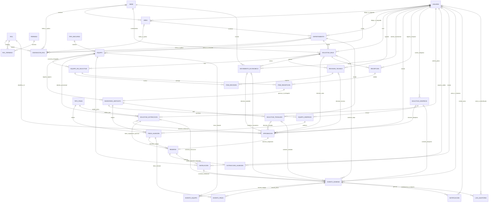

# Modelo de datos propuesto

Fuente: [referencia.pdf](../referencias/referencia.pdf), sección 6 (p. 13) y RF-01–12. Diseño conceptual para PostgreSQL y ORM Django; no se crean tablas ni migraciones. «Propuesta» identifica ampliaciones técnicas del modelo documental, no nuevos requisitos aprobados.

## Entidades

Identificadores internos por entidad. Inventarios y series como texto para conservar ceros; formato institucional pendiente. Fechas de eventos con zona horaria; propuesta: UTC en almacenamiento y America/Havana en presentación.

| Entidad y origen | Atributos y relaciones |
|---|---|
| Sede — PDF | nombre, dirección; 1:N áreas, jefe de Economía por sede |
| Área — PDF | nombre, descripción (RF-01), sede FK, jefe usuario FK; 1:N departamentos |
| Departamento — PDF | nombre, tipo Departamento/Dirección/Grupo, área FK, centro_costo, jefe usuario FK |
| TipoRecurso — PDF | nombre administrable; 1:N equipos |
| TipoPieza — PDF | nombre, campos_configurables JSONB; 1:N piezas |
| Usuario — RF-01.7, representación propuesta | identidad institucional issuer+subject, nombre y datos mínimos; contraseña inutilizable; sin contraseñas locales |
| Rol y Permiso — RF-01.6 | catálogos administrables, relaciones N:M entre usuarios/roles/permisos |
| AsignaciónRol — propuesta | usuario, rol y ámbito departamento/área/sede/depósito/global; no crea otro rol |
| RolPermiso — propuesta de relación RF-01.6 | rol FK, permiso FK; par único. AsignaciónRol y RolPermiso materializan las relaciones N:M de identidad |
| Equipo — propuesta para unificar RF-02/06/09/11 | identidad interna, inventario textual, tipo_recurso, marca, modelo, serie y departamento conocido; puede existir como receptor externo sin ingreso al depósito. Validación/unicidad institucional pendientes D-13; sustituye la propuesta anterior ReferenciaEquipo |
| SolicitudBaja — PDF | departamento FK, sede FK, fecha, justificación, estado, creado_por; propuesta: fotografía histórica de área y centro de costo |
| EquipoEnSolicitud — PDF | solicitud FK, tipo_recurso FK, no_inventario, modelo, marca, no_serie, estado_equipo, aprobado_tecnico, comentario |
| Aprobación — PDF | solicitud, rol_aprobador, usuario, decisión, comentario, fecha; propuesta: FKs explícitas a las distintas solicitudes aprobables y un único objetivo por registro |
| RevisiónTécnica — PDF | solicitud FK, técnico, jefe_soporte, fecha_agendada, fecha_aprobación, estado |
| MovimientoEconómico — propuesta RF-05 | solicitud_baja FK, sede competente, solicitado_por, fecha_solicitud, estado, listado_definitivo referenciado, procesado_por/fecha_inicio opcionales y aprobado_por/fecha_aprobación; referencia contable opcional solo si se acuerda; sin integración contable automática inventada |
| ItemRevisión — propuesta para checklist PDF | revisión FK, equipo_en_solicitud FK, procede, comentario |
| Recepción e ItemRecepción — propuesta RF-06 | solicitud, fecha, entregante, receptor; por equipo: entregado Sí/No, observación y vínculo al ingreso efectivo |
| InventarioDepósito — PDF | no_inventario, tipo_recurso, descripción, observaciones, área/departamento origen, entregado_por, recibido_por, fecha_ingreso, estado; propuesta: FK a equipo de solicitud y detalle de recepción |
| SolicitudDespiece — PDF | técnico, jefe_soporte, fecha_solicitud, fecha_agendada, estado, participantes; propuesta: separar agenda sugerida y confirmada |
| EquipoDespiece — relación mencionada en PDF | solicitud_despiece FK, equipo_depósito FK; propuesta: resultado y fecha de ejecución |
| PiezaAlmacén — PDF | tipo_pieza FK, origen equipo_depósito FK (inventario consultable), campo_valores JSONB, estado, fecha_ingreso, disponible; propuesta: FK al despiece productor |
| SolicitudExtracciónPieza — PDF, normalización propuesta | técnico, criterios JSONB (tipo, modelo, capacidad y búsqueda), destino_tipo, departamento destino, equipo_destino FK opcional antes de instalar, estado y fechas; pieza asignada, aprobador y fecha_instalación se obtienen de Reserva, Aprobación e Instalación, evitando fuentes independientes de verdad |
| Reserva — propuesta RF-09.4 | solicitud_extracción FK única, pieza FK obligatoria, aprobación FK, fecha_reserva y situación técnica. Es la asignación de una unidad concreta; no existe aún para solicitud pendiente sin pieza asignada |
| ExtracciónAlmacén — propuesta de detalle RF-09 | reserva FK única, ejecutado_por y fecha_extracción; constancia de salida física si se registra por separado. No inventa otra aprobación ni un nuevo requisito de formulario |
| Instalación — propuesta de normalización RF-09.5–6 | reserva FK única, equipo_receptor FK obligatorio, instalado_por, fecha_instalación; enlaza la pieza reservada con el receptor exacto. La obligatoriedad de una constancia de salida separada sigue pendiente |
| SolicitudTraslado — PDF | equipo_depósito FK, departamento_destino FK, justificación, aprobado_por, fecha, estado; actor solicitante pendiente D-06 |
| LogAuditoría — PDF | usuario, acción, entidad, entidad_id, IP, timestamp, datos_antes/después JSONB; acceso solo administrador |
| Notificación — propuesta RF-12 | destinatario, evento y solicitud relacionada, fecha, mensaje, fecha_lectura; correo opcional separado |
| EventoDominio — propuesta RF-11/12 | tipo, actor, fecha, estado_anterior/nuevo, operación y referencias explícitas a solicitud, movimiento, equipo, pieza o instalación; historial de negocio separado del log de seguridad |
| EventoEquipo y EventoPieza — propuesta | evento FK y equipo/pieza FK; pares únicos. Permiten que un mismo evento aparezca en el historial del equipo de origen, pieza y receptor sin duplicar la operación |

El PDF no obliga a que quien entrega tenga cuenta: definir representación de entregante antes de implementar. Identidad issuer+subject es propuesta pendiente del contrato OIDC; no asumir correo como identificador estable.

EquipoEnSolicitud conserva fotografía de marca/modelo/serie/estado físico para la solicitud, además del enlace a Equipo propuesto. InventarioDepósito representa el ingreso, no la identidad completa del equipo: referencia Equipo y el ItemRecepción efectivo, y conserva origen/entregante/receptor. No se obliga a que un equipo receptor externo haya estado en depósito. El inventario institucional no se declara globalmente único hasta resolver D-13.

## Relaciones principales

Cardinalidades propuestas; representar varias revisiones/recepciones no autoriza ciclos funcionales sin definir. Un detalle No entregado no genera ingreso. Unicidad global y reingresos pendientes D-13.

Cada Aprobación tiene exactamente un objetivo entre las seis relaciones opcionales dibujadas (restricción XOR propuesta), usuario, rol y fecha. Cada AsignaciónRol referencia solo los ámbitos aplicables; consistencia departamento→área→sede y ámbito global/depósito se validan, sin conceder acceso por un FK vacío. Entregante puede ser persona identificada sin cuenta y no se fuerza una relación USUARIO. Solicitante de traslado y participantes externos siguen pendientes; no se les atribuye un rol nuevo.

## Solicitud pendiente, asignación y reutilización

1. SolicitudExtracciónPieza pendiente guarda criterios y destino provisional: **0 reservas**, por tanto **0 piezas asignadas**. El PDF no fija si se preselecciona una candidata antes de aprobar; una candidata no es reserva ni cambia stock.
2. Aprobación de RF-09.3–4 crea **1 reserva para esa solicitud**, con **1 pieza concreta** y una aprobación favorable. La solicitud tiene **0..1 reserva** durante su ciclo; la unidad asignada se obtiene exclusivamente por esa reserva, no por un segundo pieza_id independiente.
3. Una pieza admite **0..N registros históricos de reserva** como capacidad de representación; **máximo 1 activa** por unidad y sin nueva asignación de una instalada mientras no exista un flujo posterior autorizado. N no autoriza devolución, sustitución, cancelación ni caducidad: siguen pendientes D-05. Si se acuerda reasignar dentro de la misma solicitud habrá que revisar el límite 0..1, no cambiarlo silenciosamente.
4. Una reserva tiene **0..1 extracción física registrada** y **0..1 instalación**. Instalación requiere pieza reservada y equipo exacto obligatorio; solicitud pendiente puede carecer de equipo exacto. La constancia separada de salida es propuesta de representación del paso descrito en el HTML, no se exige un trámite adicional sin confirmación.
5. La pieza mantiene su origen, aunque sea reservada o instalada. Su estado físico (Bueno/Regular/etc.) y su disponibilidad son dimensiones distintas. Stock disponible se deriva de unidades utilizables según regla por acordar y no reservadas/instaladas; no se decrece dos veces al reservar e instalar.

## Movimiento económico y aprobaciones

RF-05 exige: petición del jefe de departamento, consulta por Economía de la sede, procesamiento en sistema contable externo y aprobación con aviso a soporte. MovimientoEconómico deja evidencia de quién solicita y cuándo, solicitud/listado técnico definitivo y sede competente. La aprobación referencia ese movimiento, registra actor/rol/decisión/fecha y produce evento y notificación sin alterar los equipos aprobados.

El inicio de En Proceso Económico no tiene disparador definido en PDF. Campos de inicio/procesador son opcionales hasta acordar ese paso; no asumir sincronización contable, número de comprobante obligatorio, rechazo económico ni múltiples movimientos operativos. El modelo permite historia, pero el número de movimientos válidos por baja queda pendiente D-02. La sede histórica y el listado no deben cambiar por editar nomencladores. Una corrección del listado aprobado requiere regla autorizada; no se agrega aquí.

## Trazabilidad y auditoría

Cadena de equipo: Equipo → EquipoEnSolicitud → SolicitudBaja → revisiones/aprobaciones → MovimientoEconómico/aprobación → ItemRecepción → InventarioDepósito → EquipoDespiece → piezas; y SolicitudTraslado para salida. Marca/modelo/serie se consultan por Equipo y fotografía de solicitud, preservando datos históricos.

Cadena de pieza: PiezaAlmacén → EquipoDespiece/ingreso/equipo origen → Reserva → solicitud/aprobación → extracción registrada si aplica → Instalación → Equipo receptor. EventoEquipo vincula la instalación tanto con origen como receptor cuando corresponde; EventoPieza permite consulta individual. No identificar dos piezas por marca/capacidad ni por ejemplos visuales; usar ID interno y serie como dato sujeto a validación.

Cada operación relevante produce EventoDominio con referencia a sus documentos, actor/fecha y transición; varias referencias de contexto pueden coexistir (por ejemplo instalación y extracción). Lectura de historia ordenada por fecha e ID de evento, sin presentar aprobaciones o instalaciones todavía inexistentes como hechos. Notificación deriva del evento y se dirige solo a destinatarios RF-12. Lectura/fecha_lectura es propuesta técnica; no cambia el estado de negocio.

LogAuditoría conserva usuario identificado si existe, acción, fecha/IP, objetivo y datos mínimos antes/después. Acciones sin identidad resuelta o eventos técnicos no reciben un usuario ficticio. No todas las lecturas generan EventoDominio, pero las acciones de usuario deben quedar auditadas según RNF-02.4/A-06. Solo administrador consulta logs; lectura de trazabilidad se rige por [PERMISOS.md](PERMISOS.md). Correcciones históricas, retención y datos de entregantes/participantes requieren política institucional, no borrado automático ni valores inventados.

## Integridad y concurrencia propuestas

- Único `(solicitud, no_inventario)` por RF-02.4; acordar normalización y formato, sin imponer el ejemplo INV.
- FKs con protección de historia; proponer desactivación para nomencladores usados en vez de borrado destructivo, pendiente de validación del CRUD.
- Un resultado por equipo/revisión; conservar equipos no aprobados. Bloquear listado al jefe de departamento tras aprobación técnica.
- Transacciones para aprobación, cambio de estado, historial y auditoría; prevenir recepción/registro duplicado por reintentos.
- Una pieza es una unidad trazable. Stock agregado por tipo/atributos; reserva reduce disponibilidad y no elimina unidad.
- Bloqueo de fila y restricción de reserva activa única por pieza para evitar dos aprobaciones concurrentes; actualizar pieza, solicitud e historial atómicamente.
- Disponible/reservada/instalada como ciclo técnico propuesto desde RF-09; no mantener estado y booleano disponible independientes. No automatizar caducidad/cancelación/devolución sin resolver D-05.
- Instalación exige inventario receptor exacto, actor y fecha; preservar origen y destino aunque receptor no esté en depósito. Fuente de validación del receptor pendiente.
- Esquemas de campos configurables con tipos, obligatoriedad/opciones y versión o fotografía histórica (propuesta); validar JSONB en servidor. No ejecutar código en campos dinámicos.
- Separar estado físico Roto/Funcionando, estado de proceso y decisión técnica; no habilitar edición libre de transiciones.
- Auditoría sin tokens/secretos ni copias innecesarias de datos personales; retención por definir. Cifrado en reposo obligatorio según RNF-02.6; claves fuera de BD y backups cifrados como propuesta operativa.

Índices propuestos en FKs, inventario, fechas y estados; evaluar marca/modelo/serie e índices JSONB con consultas y volumen reales. Paginación para inventarios. Resolver D-03/D-05/D-06/D-13 de [REQUISITOS.md](REQUISITOS.md) antes de cerrar migraciones.
